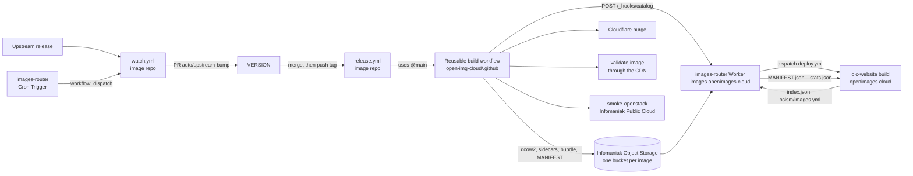

# Architecture

How an image goes from an upstream release to `images.openimages.cloud` and the website. This
page describes the code on the `main` branches of the
[open-img-cloud](https://github.com/open-img-cloud) repositories; the file paths below are
relative to those repositories.

## Repositories

| Repository | Role |
|---|---|
| One repository per image (`debian-13`, `alpine-linux`, `freebsd`, ...) | `VERSION`, build hooks under `build/`, thin `release.yml` and `watch.yml` callers. GPL-2.0 |
| [`.github`](https://github.com/open-img-cloud/.github) | Reusable workflows, composite actions, cloud-init policy template, [conventions](https://github.com/open-img-cloud/.github/blob/main/CONVENTIONS.md), [image standards](https://github.com/open-img-cloud/.github/blob/main/docs/IMAGE_STANDARDS.md), organization profile. GPL-2.0 |
| [`images-router`](https://github.com/open-img-cloud/images-router) | Cloudflare Worker serving `images.openimages.cloud`, schedulers, download statistics, catalog hook. GPL-2.0 |
| [`oic-website`](https://github.com/open-img-cloud/oic-website) | Astro site on Cloudflare Workers: catalog, guides, `index.json`, osism export. Apache-2.0 |
| [`oic-sync`](https://github.com/open-img-cloud/oic-sync) | Glance synchronization CLI ([oic-sync](oic-sync.md)). Apache-2.0 |
| [`stackopshq/libguestfs-tools-container`](https://github.com/stackopshq/libguestfs-tools-container) (outside the organization) | Builder container `ghcr.io/stackopshq/libguestfs-tools`, signed with cosign |

Image repositories consume the reusable workflows at `@main`, not at a tag: a change merged in
`.github` applies to every image at its next build.

## Build engines

Each `release.yml` calls exactly one reusable workflow of `open-img-cloud/.github`:

| Workflow | Used for | How |
|---|---|---|
| `build-libguestfs-image.yml` | Most distributions: customized upstream cloud images | Download and check the upstream image, run the repo's `build/customize.sh`, inject `99_oic-policy.cfg`, `virt-sysprep`, `virt-sparsify --compress`, then boot test in QEMU with a ConfigDrive seed |
| `build-dib-image.yml` | Octavia, Manila, Trove, Gentoo | Run the repo's `build/dib-build.sh` (diskimage-builder) |
| `build-nix-flake-image.yml` | NixOS | Run the repo's Nix build script |
| `build-freebsd-image.yml` | FreeBSD | Build in an ephemeral FreeBSD VM (or on a FreeBSD runner), convert to compressed qcow2, then a separate release job |

These four workflow paths are exactly what the cosign identity expression accepts
([Verifying images](verifying-images.md)); adding a fifth engine means updating that expression
everywhere it is published.

Common to all engines, after the build:

1. Checksums (`.md5`, `.sha1`, `.sha256`, `SHA256SUMS`).
2. `cosign sign-blob` in keyless mode with GitHub OIDC (`id-token: write`), producing
   `<file>.bundle`.
3. `MANIFEST.json` (provenance: commit, CI run, builder image and digest, upstream URL).
4. **Publish** (`actions/publish-image`): upload to the image's bucket under `<version>/`, mirror
   to `latest/` unless disabled, add `sha512`, `size`, `virtual_size`, `firmware`, `arch` to the
   manifest, write an `index.html` listing, rebuild `versions.json` at the bucket root.
5. **Purge** the Cloudflare cache for the affected URLs (`actions/cf-purge`).
6. **Validate** through the public CDN (`actions/validate-image`): manifest keys, cosign, sidecars,
   size, cache headers.
7. **Runtime test** on Infomaniak Public Cloud (`actions/smoke-openstack`) when the caller sets
   `runtime_smoke_login_user` ([image contract](image-contract.md)).
8. **Catalog hook**: `POST https://images.openimages.cloud/_hooks/catalog` with a GitHub OIDC
   token, so the website (and `index.json`) is rebuilt right away. Best effort: the daily site
   build is the fallback.

Steps 4 to 8 only run when `publish` is true (tag push). A `workflow_dispatch` run defaults to
`publish: false`: the image is built (and signed, the `sign` input defaults to true) but nothing
is uploaded. The image repository's `release.yml` passes the inputs; see the reusable workflow
files for the full list.

### Builder and runners

- The libguestfs and DIB workflows default to the builder `ghcr.io/stackopshq/libguestfs-tools`,
  pinned to an exact version in the workflow inputs, and verify its cosign signature in a
  `verify-builder` job before anything runs. Repositories that build in `ubuntu:24.04` (Octavia,
  Manila, Trove, Gentoo, NixOS) set `verify_builder: false` and document why.
- Runners default to GitHub-hosted `ubuntu-latest` (which exposes `/dev/kvm`); the
  `runner_labels` input can target self-hosted KVM runners.

### Upstream integrity (libguestfs path)

The base image is checked against, in order of precedence: a hash passed by the caller
(`upstream_sha256`, for upstreams that publish it only on a web page), the upstream checksum list
(`upstream_checksum_url`, SHA-256 or SHA-512, a missing entry fails the build), or a
`<url>.sha256` file next to the upstream image. When none of these exists the build only emits a
warning, and the cosign signature of the result remains the downstream guarantee.

## Storage

One **public, versioned bucket per image** on Infomaniak Object Storage (Ceph S3, Switzerland),
named after the image id. Paths: `<version>/<file>` and `latest/<file>` in the bucket, plus
`versions.json` at the root. Buckets are created by hand at onboarding; `publish-image` does not
create them. The upload credentials (`OIC_S3_KEY_ID`, `OIC_S3_SECRET`) are organization secrets.

## images-router (CDN Worker)

A Cloudflare Worker on the route `images.openimages.cloud/*` (`images-router/src/index.js`):

- **Routing:** the first path segment selects the bucket, the rest is the object key. Only buckets
  listed in `ALLOWED_BUCKETS` (`wrangler.toml`) are served; anything else is a 404. A path ending
  in `/` serves that directory's `index.html`.
- **Caching:** versioned paths `public, max-age=31536000, immutable`; `latest/` and bucket-root
  files `public, max-age=300`. Range and conditional requests are forwarded.
- **Catalog relay:** `/index.json` and `/osism/images.yml` are fetched from
  `https://openimages.cloud` and served from the registry host.
- **Download statistics:** each counted qcow2 download is written to Workers Analytics Engine
  (dataset `oic_downloads`); `/_stats.json` serves the aggregates. CI User-Agents are excluded.
- **Schedulers** (Cron Triggers): every day at 05:40 UTC the Worker dispatches the `watch.yml` of
  each repository listed in `SCHEDULED_WORKFLOWS` and the website `deploy.yml`; every Monday at
  04:00 UTC it dispatches `.github`'s `catalog-audit.yml`. GitHub disables `schedule:` triggers
  of inactive public repositories after 60 days, `workflow_dispatch` is not affected; the
  repositories keep their own `schedule:` as a fallback.
- **Catalog hook** (`src/hooks.js`): `POST /_hooks/catalog` accepts a GitHub Actions OIDC token
  for its own audience, from a workflow of the `open-img-cloud` organization on a `main` branch,
  and dispatches the website deploy.

The Worker deploys on push to `main`.

## Website

`oic-website` is an Astro site deployed to Cloudflare Workers by `deploy.yml`: on push to `main`,
daily at 07:30 UTC, and when dispatched by the Worker (daily scheduler and catalog hook).

- The curated list of images is `src/data/images.yaml` (title, description, repository, login
  user, variants, `os_distro`, status, featured position...).
- At build time the site reads each image's `latest/MANIFEST*.json` from the registry. The
  published `latest/` manifest is the source of truth for the current version; `images.yaml` is
  only a fallback.
- It generates the image pages with ready-to-copy commands, `/verify/`, `/quality/`, `/about/`,
  and the machine-readable [`index.json` and osism export](catalog-index.md).

## Release flow

1. **Watch.** `watch.yml` (daily, from its own cron and from the Worker) calls `upstream-watch.yml`,
   which runs the repository's `build/detect-upstream.sh`. When the upstream version differs from
   `VERSION`, it opens or updates a pull request on the branch `auto/upstream-bump`.
   Service images follow OpenStack series; Octavia has no watcher and is bumped by hand.
2. **Merge** the pull request (manual).
3. **Tag** `v<VERSION>` and push the tag (manual). Nothing creates the tag automatically.
4. **Release.** The tag triggers `release.yml`, which resolves the version and calls the reusable
   build workflow: build, sign, publish, purge, validate, runtime test, catalog hook.
5. **Catalog.** The website and `index.json` follow through the hook, or at the next daily build.
6. **Audit.** Every Monday `catalog-audit.yml` revalidates every `latest/` artifact and opens,
   updates or closes a "Catalog audit" issue in `open-img-cloud/.github`.

Some repositories (Octavia, Manila, Trove) also have `sync-latest.yml`, a manual workflow that
points `latest/` to an already published version without rebuilding.

## Secrets

Release secrets are set at the organization level and inherited by the image repositories:
`OIC_S3_KEY_ID`, `OIC_S3_SECRET` (object storage), `CF_ZONE_ID`, `CF_API_TOKEN` (cache purge),
`OS_AUTH_URL`, `OS_REGION_NAME`, `OS_APPLICATION_CREDENTIAL_ID`,
`OS_APPLICATION_CREDENTIAL_SECRET` (runtime test). The reusable workflows declare them optional
so that dry runs work without them, and fail fast when `publish` is true and one is missing. The
Worker holds its own `GH_DISPATCH_TOKEN` for the dispatches.
